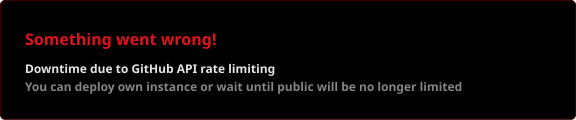

### About Me

- 🧱 Frontend: responsive layout from Figma mockups — HTML, CSS, Sass, BEM
- ⚙️ Learning JavaScript now, then TypeScript and React
- 🚀 Building real production projects instead of tutorials
- 📈 Later: Python and Rust, growing into a fullstack developer

 

### Projects

#### 🚢 <a href="https://bulbulship.ru">BulBulShip</a> — website for a houseboat sales company

Team commercial project, live in production since autumn 2026. Responsive multi-page site with photo galleries, sliders and a contact flow.

<!-- скриншоты: десктоп и мобильная версия, файлы положить в profile/img/ и вставить:

 
 -->

- **Task:** a sales site for houseboats: test-drive offer, selection and delivery across Russia
- **My part:** UI design in Figma and frontend — responsive layout (1440 / 1024 / 768 / 375 px), BEM + Sass, vanilla JavaScript (gallery, slider, dialogs, menu, preloader, smooth scroll), image optimisation, SEO basics (meta tags, Open Graph, JSON-LD, sitemap)
- **Workflow:** Git, branches dev → stage → main; deployment (Docker, Nginx) is handled by a teammate
- **Stack:** HTML, CSS (Sass), BEM, JavaScript, Git, Figma

 

### 🛠️ Stack

### 🧰 Tools

### 🧭 Later

 

### 📊 GitHub Stats

 

### 📫 Get in Touch

